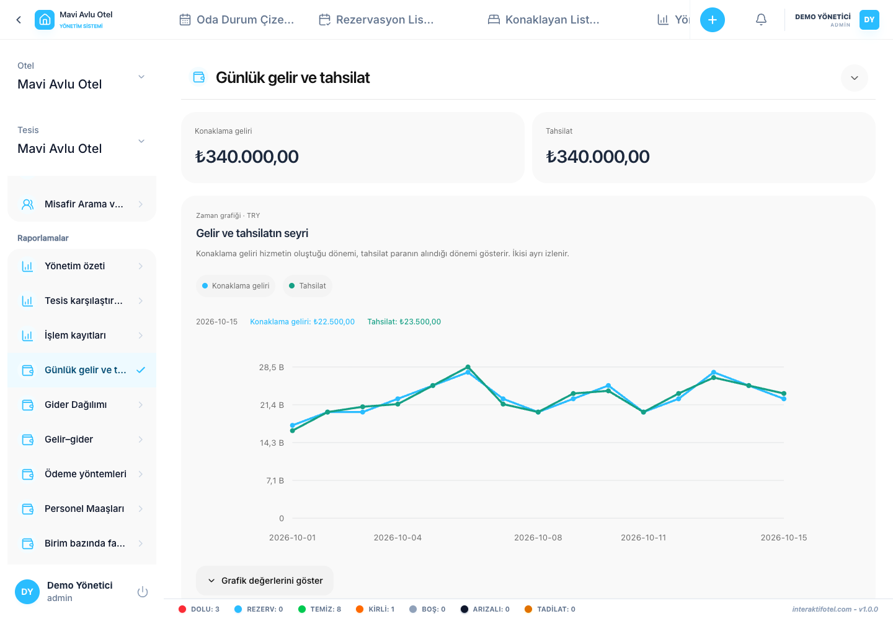

# Raporları kullanma ve yorumlama

**Nereden açılır?** Sol menüdeki **Raporlamalar**. Raporlar yönetici ve işletme yönetimi rollerine açıktır; yalnızca erişebildiğiniz tesisler değerlendirilir.

## Rapor hazırlayın

1. İncelemek istediğiniz raporu seçin. Genel durum için **Yönetim özeti** ile başlayın.
2. Başlangıç ve bitiş tarihini belirleyin. Bitiş günü rapora dahildir.
3. Tesis ve para birimi seçimlerini kontrol edin; diğer filtreleri amacınıza göre daraltın.
4. Sonuç kartlarını, grafikleri ve tabloyu birlikte inceleyin.
5. Veri görünmüyorsa önce seçili dönem ve filtreleri kontrol edin.

Bir sorguda en fazla 366 günlük aralık desteklenir. Çok büyük veri uyarısında aralığı kısaltarak ayrı raporlar alın. Rapor tarihleri İstanbul saat dilimiyle değerlendirilir.

## Gelir ve tahsilat farklıdır

**Konaklama geliri**, hizmetin verildiği geceleri; **tahsilat**, paranın alındığı zamanı ifade eder. Gelecek ayın konaklaması için bugün alınan ödeme, iki raporda aynı güne yazılmak zorunda değildir.

Farklı para birimleri otomatik çevrilmez ve tek toplamda birleştirilmez. Faaliyet sonucu, vergi/finansman sonrası muhasebe kârı olarak yorumlanmamalıdır. Birim bazlı sonuçlarda yalnızca birime atanmış giderler bulunur; dağıtılmamış giderleri ayrıca okuyun.

## Doluluk oranını okuyun

Fiziksel kapasite ile satılabilir kapasite farklı paydalardır. Satışa kapalı birimler sonucu etkileyebilir. Geçmiş kapasite değişiklikleri saklanmadığı için geçmiş doluluk hesabında mevcut fiziksel tanımlara dayanan sınırlamayı dikkate alın. Yatak yeri sayısı ile kişi kapasitesini karıştırmayın.

## Ödeme yöntemlerini inceleyin

Kredi kartı, havale, nakit ve diğer ödeme kanallarını karşılaştırın. Tahsilat ve iade tutarlarını ayrı değerlendirin. Grafiği anlamlandırmadan önce tarih ve para birimini doğrulayın.

## Dışa aktarma ve rapor belgesi

CSV seçili raporun tüm satırlarını içerir. **Belge hazırla** mevcut filtrelerin verileriyle düzenlenebilir bir rapor belgesi oluşturur. Açıklamalarınızı ekleyip HTML indirebilir veya tarayıcıdan PDF yazdırabilirsiniz. Düzenlenebilir belge en fazla 1.000 tablo satırı içerir; kesilen satır varsa tam döküm için CSV kullanın.

Rapor türlerini seçmek için [57 raporluk kataloğa](report-catalog.md), eksik kaynakları tamamlamak için [işlem kayıtlarına](transactions.md) geçin.
