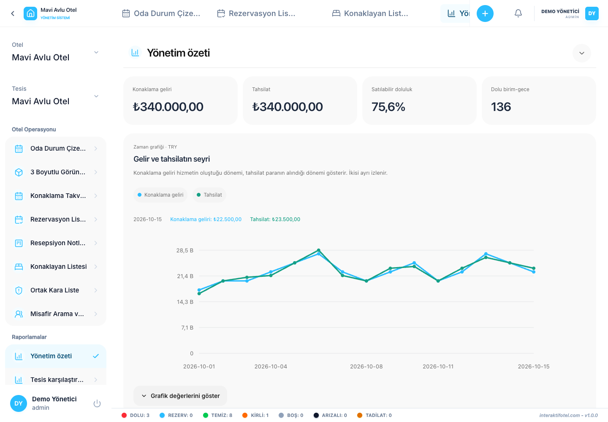
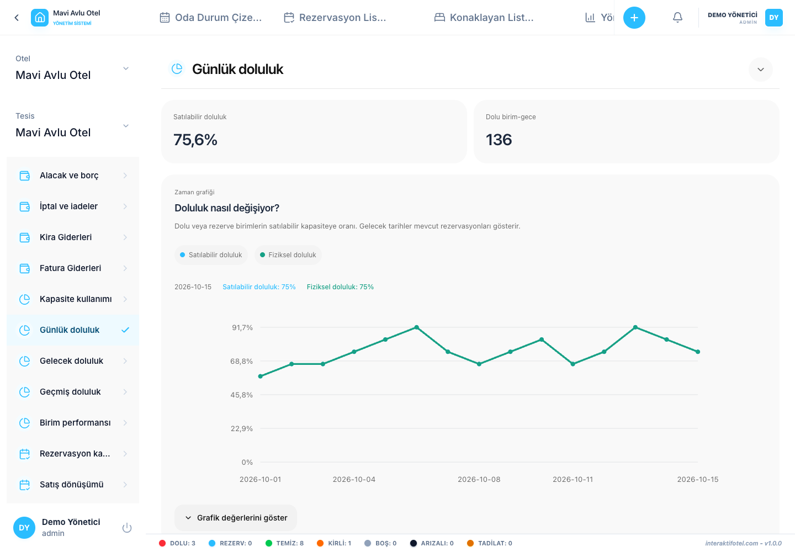

# Berichte verwenden und auswerten

Öffnen Sie Berichte im linken Menü. Berichte sind für die Verwaltungs- und Geschäftsführungspositionen innerhalb ihres Zugangsbereichs zu den Hotelbranchen verfügbar.

## Bereiten Sie einen Bericht vor

1. Wählen Sie den Bericht aus, den Sie brauchen. Beginnen Sie mit einer Übersicht über das Management für ein allgemeines Bild.
2. Setzen Sie Start- und Enddaten. Das Enddatum ist enthalten.
3. Überprüfen Sie die Filialen und Währungen des Hotels und schränken Sie alle anderen Filter ein.
4. Lesen Sie zusammen Zusammenfassungskarten, Diagramme und den Tabelle.
5. Wenn keine Ergebnisse zu finden sind, überprüfen Sie zuerst die Periode und die Filter.

Eine Abfrage kann bis zu 366 Tage dauern. Wenn die Datenmenge-Grenze erreicht wird, verkürzen Sie den Zeitraum und erstellen Sie separate Berichte. Die Berichtsdaten werden in der Zeitzone Istanbul verwendet.

## Die Einnahmen und das Geld sind unterschiedlich.

Die Einnahmen aus Unterkünften beziehen sich auf die Nächte, in denen der Dienst erbracht wird. Die erhaltenen Zahlungen beziehen sich auf die Ankunft des Geldes. Das heute für den nächsten Monat erhaltene Geld muss bei beiden Maßnahmen nicht am selben Tag erscheinen.

Währungen werden weder automatisch konvertiert noch in eine Gesamtzahl kombiniert. Das Betriebsergebnis ist kein Rechnungslegungs-Neto-Gewinn nach Steuern und Finanzierungen. Die Ergebnisse auf Einheitsebene umfassen nur Ausgaben, die der Einheit zugeordnet sind; überprüfen Sie die nicht zugewiesenen Ausgaben separat.

## Lesen Sie die Beschäftigungsquoten

Die physikalische Kapazität und die verkaufbare Kapazität verwenden verschiedene Nenner. Einheiten, die nicht verkauft werden, können das Ergebnis beeinflussen. Die historischen Kapazitätsveränderungen wurden nicht gespeichert, so dass die Berechnungen der historischen Besatzung sich auf aktuelle physikalische Definitionen stützen. Die Anzahl der Zimmer und die Gästekapazität sind unterschiedliche Maßnahmen.

## Überprüfung der Zahlungsmethoden

Vergleichen Sie Kreditkarten, Banküberweisungen, Bargeld und andere Zahlungsmittel. Lesen Sie die Quittungen und Rückerstattungen separat. Überprüfen Sie Daten und Währungen, bevor Sie das Diagramm interpretieren.

## Ausfuhr und Erstellung von Berichtsdokumenten

CSV umfasst alle Zeilen des ausgewählten Berichts. Vorbereiten Sie das Dokument erstellt einen bearbeitbaren Bericht mit den aktuellen Filtern. Hinzufügen von Erklärungen und herunterladen HTML oder PDF-Druck im Browser. Bearbeitbare Dokumente enthalten höchstens 1.000 Tabellenzeilen. Wenn Zeilen ausgelassen sind, verwenden Sie CSV für den kompletten Datensatz.

Wählen Sie einen Bericht aus der [57-Berichtskatalog](report-catalog.md). Die fehlenden Quelldaten mit [Transaktionsregister](transactions.md).
