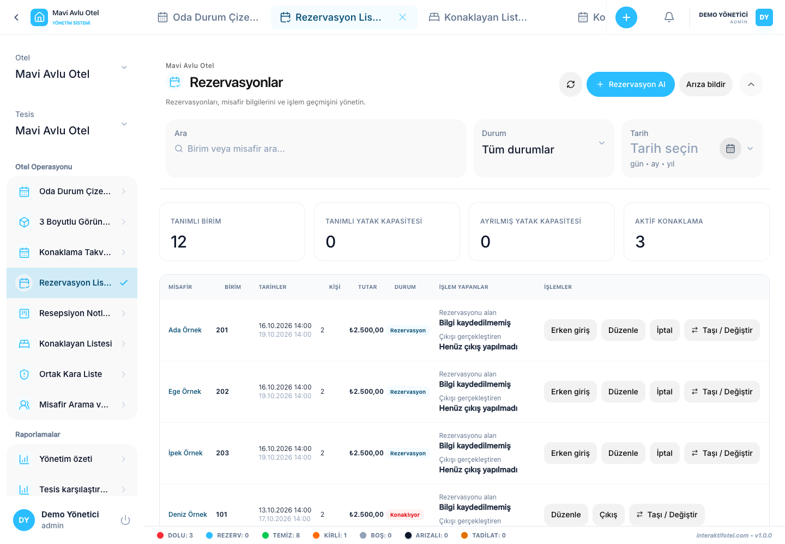

# Reservierungen erstellen und bearbeiten

Öffnen Sie die Reservierungsliste oder reservieren Sie eine Einheit im Zimmerstatus.

## Erstellen Sie eine Reservierung

1. Wählen Sie die richtige Zweigniederlassung des Hotels aus und öffnen Sie ein neues Buchungsformular.
2. Überprüfung von Ankunft, Nacht und Abreise. Nach Änderung eines Feldes überprüfen Sie die berechneten Werte der anderen.
3. Geben Sie den Inhaber der Reservierung und die Anzahl der Gäste ein.
4. Füllen Sie die Felder Name, Telefon, Identität/Reisepass und Staatsangehörigkeit jedes Gastes aus. Das Geschlecht ist optional.
5. Wählen Sie das richtige Zimmer, die richtige Wohnung oder das richtige Bett im Bereich "Vermietungseinheit".
6. Überprüfen Sie den Nachtpreis und alle anderen Gebühren oder Vorauszahlungsfelder. Der Nachtpreis ist nicht der Gesamtpreis des Aufenthalts.
7. Hinzufügen von Informationen, die für die nächste Schicht notwendig sind, in die Notizen.
8. Speichern und bestätigen, dass die Reservierung mit der richtigen Einheit und den richtigen Daten angezeigt wird.

Beispiel: Ankunft am 15. Oktober und Abreise am 18. Oktober bedeuten drei Nächte. Eine weitere Reservierung kann am 18. Oktober zum Abflug beginnen. Ein Gast, der sich noch nicht ausgecheckt hat, kann die Einheit auch nach der geplanten Abreise blockieren.

## Warum ist eine Einheit nicht verfügbar?

Die Termine können mit einer anderen Buchung, einer Reservierung einer Eltern- oder Kindseinheit oder einem ungeeigneten Einheitsstatus im Widerspruch stehen. Eine Reservierung einer ganzen Wohnung blockiert die Zimmer für denselben Zeitraum. Wenn man ein Zimmer reserviert, werden die Betten blockiert. Unabhängig gemietete Betten im selben Zimmer können separat reserviert werden.

## Bearbeiten Sie die Daten

1. Öffnen Sie die Reservierungsdetails.
2. Wählen Sie Datum der Reservierung bearbeiten.
3. Überprüfen und speichern Sie die neuen Termine und Preisfelder.
4. Überprüfen Sie die Änderungen im Kalender.

Sie können die geplanten Termine nach dem Check-in bearbeiten. Die tatsächliche Ankunftszeit und die vorherigen Bewegungen der Einheit bleiben unverändert. Die neue Abreise muss in Zukunft sein und darf nicht mit einer anderen Buchung in Konflikt treten. Verwenden [Umzug](move-and-cancel.md) Um die Einheit zu wechseln.

Als Nächstes: [Anmeldung von Gästen](check-in-out.md).
