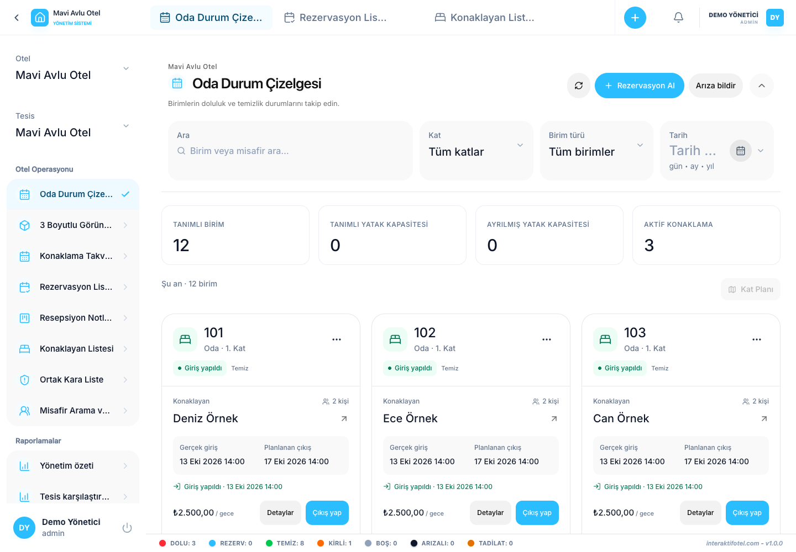

# Room Status Board and cleaning

Open the Room Status Board under Hotel Operations.

## Read a room card

Read the unit code, guest or reservation information and arrival/departure dates together. Occupancy and cleaning are different: a clean room may be occupied, and an empty room may still need cleaning. Read the status label instead of relying only on color.

## Find a unit

1. Confirm the selected property.
2. Adjust search, floor and date filters as needed.
3. Check the unit code on the card.
4. Open the card's action menu. On desktop, the right-click menu also provides reservation, guest, status and document actions.

When viewing another date, do not confuse that date's reservation status with the current cleaning status.

## Change cleaning status

1. Confirm the prepared room's code with the responsible staff member.
2. Open the room status control on the card.
3. Select Clean or Dirty according to the actual condition.
4. Wait for confirmation and check the updated label.

Authorized accounts also have Vacant, Out of order and Under renovation options. Before recording maintenance or a fault, check existing stays and upcoming reservations. Complete any reason or confirmation fields requested by the application.

## If check-in is blocked

The application checks cleaning, active stays and availability from the actual arrival time through the planned departure. If a dirty-room warning appears, check the exact room or bed code, refresh and verify the current status.

If the problem continues, follow the [troubleshooting steps](../reference/troubleshooting.md).
