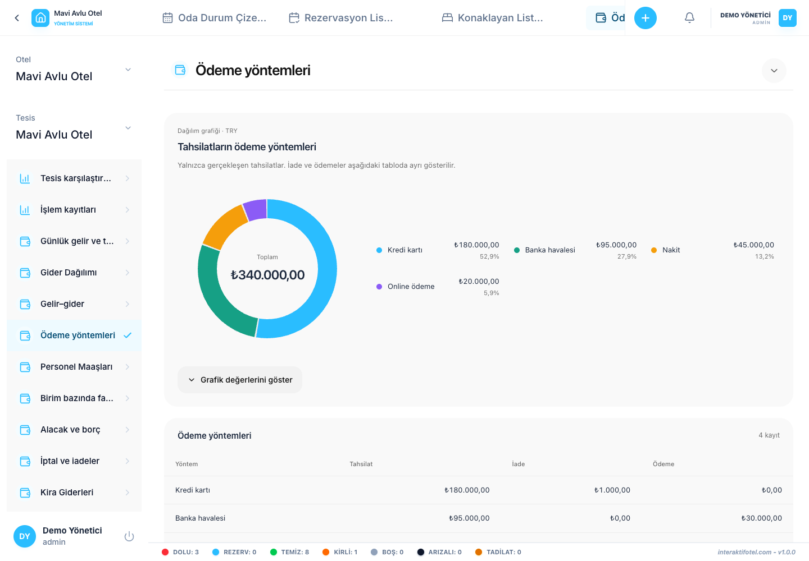

# レポートの使い方と読み方

左のメニューでレポートを開きます. 報告は,管理者および事業管理の役割に対して,ホテルの支店へのアクセス範囲内で提供されます.

## 報告を準備する

1. 必要なレポートを選んでください. 管理の概要から始めましょう
2. 開始日と終了日を設定する. 終了日程も含まれています.
3. ホテルの支店と通貨の選択をチェックし 他のフィルターを絞る
4. 概要カード,チャート,テーブルを一緒に読みましょう.
5. 結果が出ない場合は 期間とフィルターをチェックしてください.

查询は 366日まで対応します データの量制限が達成された場合,期間を短縮し,別々のレポートを作成します. 報告書の日付はイスタンブールの時間帯を使用します.

## 収入と受け取ったお金は違います

宿泊収入は,サービスが提供される夜に関連しています. 受け取った支払いは,お金が届く時に関連しています. 今度の来月の滞在に受け取った金額は,両方の措置において同じ日に表示される必要はありません.

通貨は自動的に変換されず,合計で結合されず, 運算結果は,税金と資金調達後の純利益の会計ではありません. ユニットレベルでの結果は,ユニットに割り当てられた支出のみを含みます. 分割されていない支出を別々に検査します.

## 占用率を読み取る

物理的容量と販売可能な容量は異なる表記者を使用する. 販売終了したユニットは結果に影響を与える可能性があります. 歴史的な容量変更は保存されなかったため,歴史的な占用量計算は現在の物理的定義に基づいています. ベッドスペースとゲスト容量とは 異なる指標です

## 支払い方法のレビュー

クレジットカード,銀行送金,現金,その他の支払い経路を比較する. 領収と返済を別々に読む グラフを解釈する前に日付と通貨を確認する.

## 輸出及び報告文書の作成

CSVは,選択したレポートのすべての行を含みます. 準備ドキュメントは,現在のフィルタを使用して編集可能なレポートを作成します. 説明を追加し,ブラウザでHTMLまたはPDFにプリントをダウンロードします. 編集可能な文書に含められる表の行数は最大 1,000 行です。 列が省略された場合,完全なデータセットの CSV を使用します.

報告書を選択する [57報告書のカタログ](report-catalog.md). 失踪したソースデータを完備して [取引記録](transactions.md).
