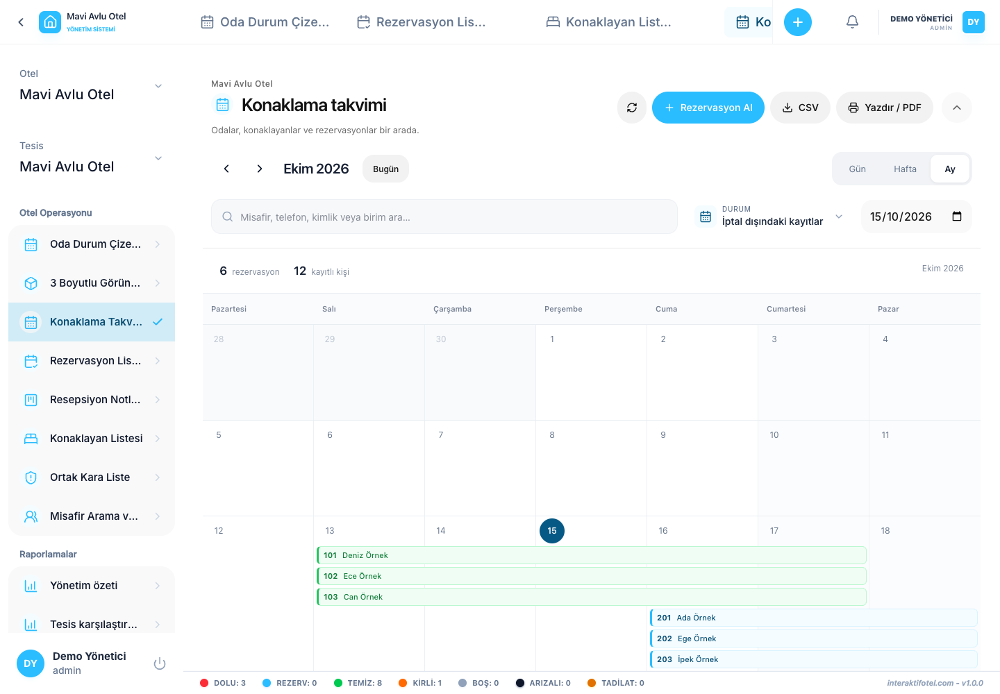

# 宿泊カレンダーと滞在中のゲスト

## カレンダーに留まる

1. メニューから滞在カレンダーを開く
2. 必要な期間へ移動し,日,週,または毎月のビューを選択します.
3. 検索とステータスフィルターで結果を絞る
4. ゲスト,日付,メモ,そして夜間価格をチェックするために宿泊場所を選択してください.
5. 期間またはフィルターを変更した後,結果は新しい選択と一致していることを確認します.

CSV輸出には,選択された期間におけるフィルタリングされた単位割り当てが含まれています. プリント/PDFはブラウザのプリントダイアログで可視なカレンダーを開きます. PDFの目的地を選択してファイルとして保存します.

## 現在のゲスト

現在のゲストを使用して,進行中の滞在と計画された出発を追跡します. 検索,フロア選定,開始日についてはページヘッダーに記載されています. 制御が隠されている場合 ヘッダを拡大します 期間ナビゲーション,ステータス,日数および空単位制御を必要に応じて調整する.

計画された日付と実際の到着と出発時間を区別する. 早期チェックインや部屋移動は,実際の移動が計画期間とは異なる可能性があります.

記録が消えたと仮定する前に ホテル支店,日付,フロア,状態,検索フィルターをクリアして再確認してください.

次は: [ゲストの検索と歴史](../guests/history.md).
