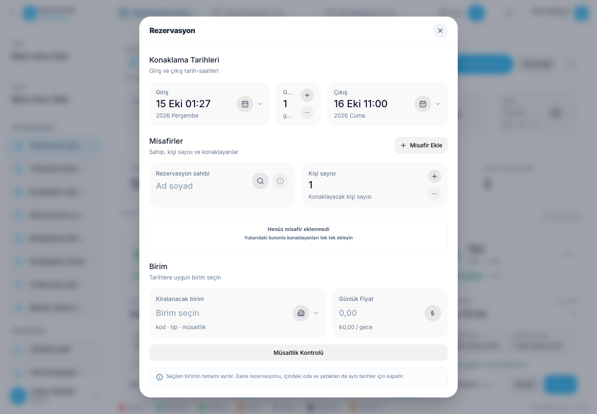

# 予約の作成と編集

予約リストを開くか 部屋のステータスボードのユニットで予約する

## 予約を作成する

1. ホテルの正しい支店を選択し,新しい予約フォームを開きます.
2. 到着,夜,出発をレビューする 1つのフィールドを変更した後,他のフィールドの計算値をチェックする.
3. 予約保持者とゲストの数を入力してください.
4. 各ゲストの名前,電話,身分/パスポート,国籍のフィールドを記入する. 性別は選択的です
5. レンタルユニットフィールドで正しい部屋,アパート,ベッドを選択します.
6. 夜間料金と他の料金や付出先決をチェックする 夜間料金とは 宿泊料の総額ではありません.
7. 次のシフトで必要な情報をノートに追加する.
8. 予約が正しい単位と日付で表示されていることを保存し確認します.

例:10月15日に到着し10月18日に出発すると3泊になります. また10月18日の出発時に予約が開始される. チェックアウトしていないお客様は 予定された出発後でも ユニットをブロックできます

## なぜユニットが利用できないのか?

予約は別の予約,親または子供ユニットの予約,または不適切なユニットのステータスと矛盾する可能性があります. 部屋を同じ期間で ブロックする 部屋を予約するとベッドが遮断されます 同じ部屋で独立に賃貸されたベッドは別々の予約が可能です.

## 日付編集

1. 予約の詳細を開いて下さい
2. 予約日付を編集する.
3. 新しい日付と価格フィールドをレビューして保存する.
4. カレンダーの変更を確認してください.

チェックイン後,予定された日付を編集できます. 実際の到着時間と以前のユニット移動は変わらない. 新しい出発は将来に行われ,他の予約と衝突してはならない. 活用する [部屋交換操作](move-and-cancel.md) ユニットを交換する

次は: [ゲストチェックイン](check-in-out.md).
