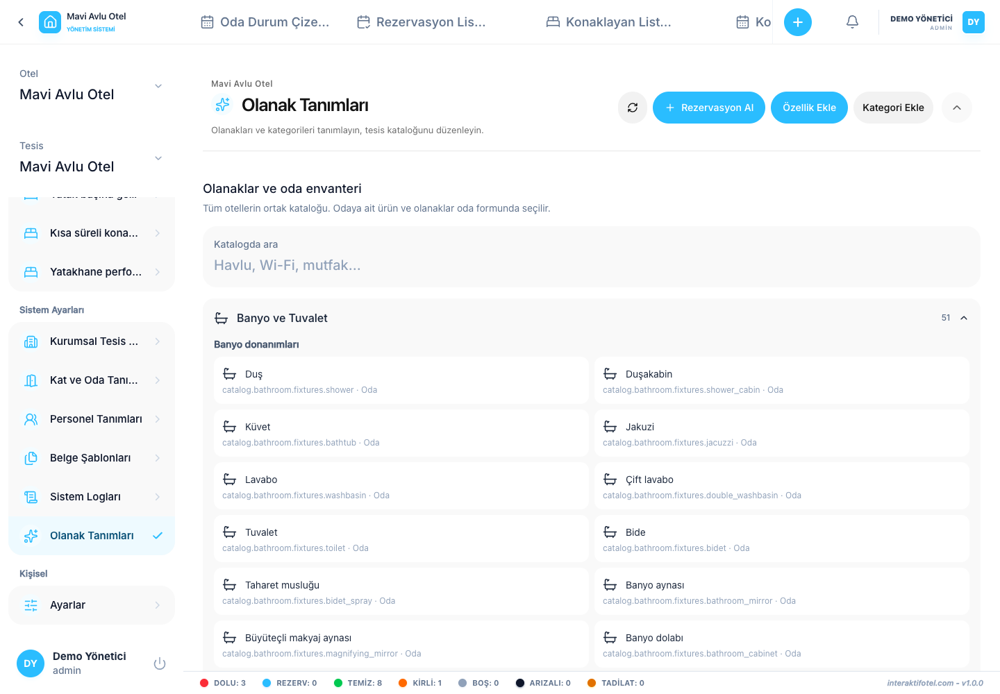

# 設備と客室備品

部屋またはホテルの支部編集フォームの機能欄と Amenity Definitions を開きます.

## 違いを理解する

- 設備は,浴室や部屋の設備などの機能が利用可能かどうかを示します.
- 物理的な物件と数量を記録する.
- 実際のベッド家具は,宿泊施設の布局とベッドスペースを記述し,ベッド管理においてそれらを別々に定義する.

## 部屋に機能を追加する

1. 便利な施設のカタログで適切なカテゴリーとサブグループを見つけます.
2. ターゲット室を編集する
3. 適用可能な設備を選択し,実際の量をインベントリーフィールドに入力します.
4. 保存する
5. 部屋を再開して 選択と量が保存されていることを確認してください

ホテルの支部レベルでの共有施設を割り当てて,各部屋に利用可能に見えるようにしてください. 共有温泉水槽と私的な温泉水浴室は 異なる特徴です

## カタログ,割り当て及びストック

標準カタログには共通の定義が含まれています. 権限のあるユーザーは,ビジネス特有の定義で作業することもできます. 商品がカタログに載っているということは,その商品が部屋に割り当てられているとは限りません.

倉庫の貨物請求書ではありません. 貯蔵庫の収入と消費を追跡する [取引記録](../finance/transactions.md) 関連ストック報告 既存の製品コードを再利用し,異なる綴りの複製製品を作成する代わりに.
