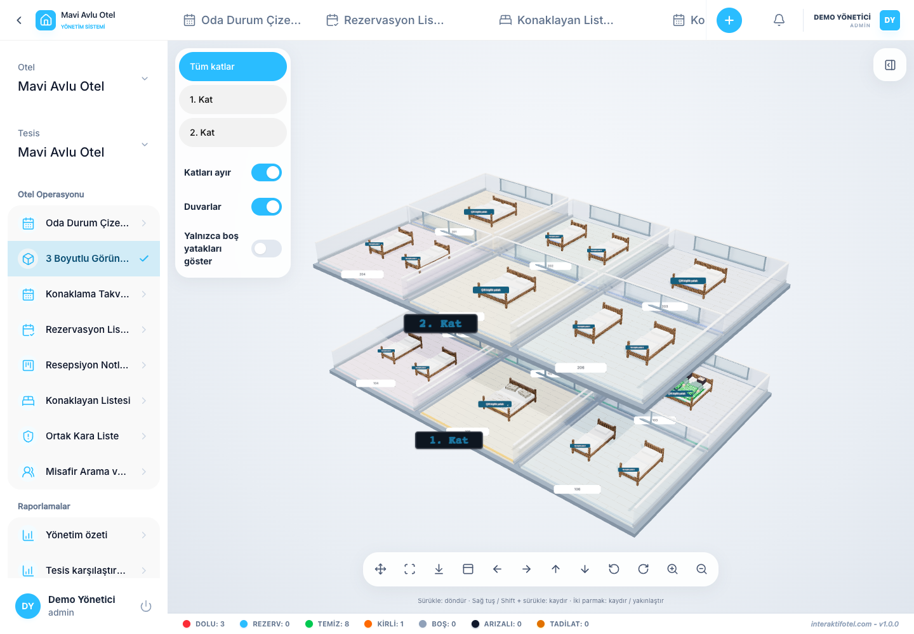

# 3D 表示

3Dビューをオープンする ホテル運営

## ホテル の 支店 を 調べる

1. 適切なホテルブランチを選択して 3Dビューを開きます.
2. 舞台内にある床のボタンを使って 床を選んでください
3. 床と壁のコントロールを使って 内部を露出します
4. 部屋やベッドを選択して,その情報と滞在状況を確認してください.
5. ご利用許可に応じて,関連する予約画面に利用可能なアクションをフォローしてください.
6. 最新状態をリフレッシュで取得します.

## 舞台を解釈する

床,部屋,ベッドはホテル部門の定義から来ています 欠落する位置や重複する位置は,スケーマ的に配置され,部屋内のベッドは自動的に配置されます. これは建築の測定やフロアプランの編集ツールではありません. 場所を探検すると保存された座標が変わらない.

部屋の予約のゲストが ベッドを横断して 視覚的に配分されることは 床の実際の割り当てを 生み出さない. 性別が指定されていないゲストは中立的な文字を使用し,性別は名前から推測されません.

## ユニットが欠落しているか,見えているか

ホテルの支店,フロア,部屋の関係,実際のベッド家具の定義とレンタルモードをチェックし,リフレッシュします. 部屋の布局の家具として選択されたスケーメティックベッドは,別々の予約ユニットを作らない.

ブラウザが3Dシーンを開けられない場合は,再試またはテキストベースのユニット選択を使用します. 日常の作業を継続することができます [部屋のステータスボード](../operations/room-board.md).
