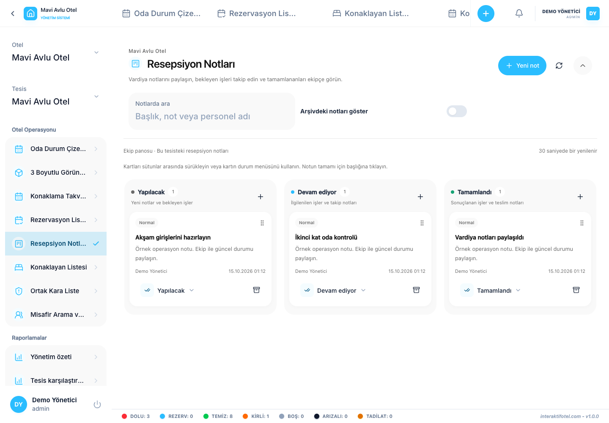

# रिसेप्सन नोट र पालो हस्तान्तरण

होटल सञ्चालनको खण्डमा स्वागत सूचना खोल्नुहोस् वा शीर्षमा सूचना बटन प्रयोग गर्नुहोस्।

## एउटा कार्य सिर्जना गर्नुहोस्

1. चयनित होटल शाखाको पुष्टि गर्नुहोस्।
2. बोर्डमा नयाँ-नोट कार्य खोल्नुहोस्।
3. एउटा छोटो कार्य-उन्मुख शीर्षक लेख्नुहोस्, जस्तै कोठा २०३ को लागि आगमन तयारी जाँच गर्नुहोस्।
4. आवश्यक काम, कोठाको जानकारी र अर्को शिफ्टको आवश्यकताहरूको विवरण थप्नुहोस्।
5. स्थिति र प्राथमिकता चयन गर्नुहोस्, त्यसपछि बचत गर्नुहोस्।
6. पुष्टि गर्नुहोस् कि नोट सही स्तम्भमा देखा पर्दछ।

## प्रगति अपडेट गर्नुहोस्

बोर्डले काम गर्नैपर्छ, प्रगतिशील र पूर्ण स्तम्भहरू। कार्ड तान्नुहोस् वा यसलाई सार्न यसको स्थिति मेनू प्रयोग गर्नुहोस्। स्थिति मेनु टच र कीबोर्ड प्रयोगको लागि पनि उपयुक्त छ।

कार्य पूरा भएपछि मात्र कार्डलाई समाप्तमा सार्नुहोस्। दैनिक बोर्डमा अब आवश्यक नभएका अभिलेखागार नोटहरू र आवश्यक भएमा तिनीहरूलाई पुनःस्थापना गर्नुहोस्। अभिलेख राख्नु स्थायी रूपमा मेटाउनु होइन।

## यदि दुई जनाले एउटै नोट सम्पादन गरे

यदि बचत अस्वीकार गरियो भने किनभने अर्को कर्मचारीले नोट परिवर्तन गर्यो भने, यसलाई फेरि खोल्नुहोस्, हालको संस्करण पढ्नुहोस् र तपाईंको परिवर्तन फेरि लागू गर्नुहोस्। बोर्ड नियमित रूपमा ताजा हुन्छ जब तपाईं खोल्नुहुन्छ र जब तपाईं विन्डोमा फर्कनुहुन्छ। खोज प्रयोग गर्नुहोस् र अधिक लोड गर्नुहोस् यदि कार्ड दृश्यमान छैन भने।

नोटहरू होटल शाखा भित्र साझा गरिन्छ। नोट पूरा गर्दा कोठाको सफाई, आरक्षण वा वित्तीय रेकर्ड स्वचालित रूपमा अपडेट हुँदैन। साथै यसको सम्बन्धित स्क्रिनमा वास्तविक अपरेसन गर्नुहोस्।
