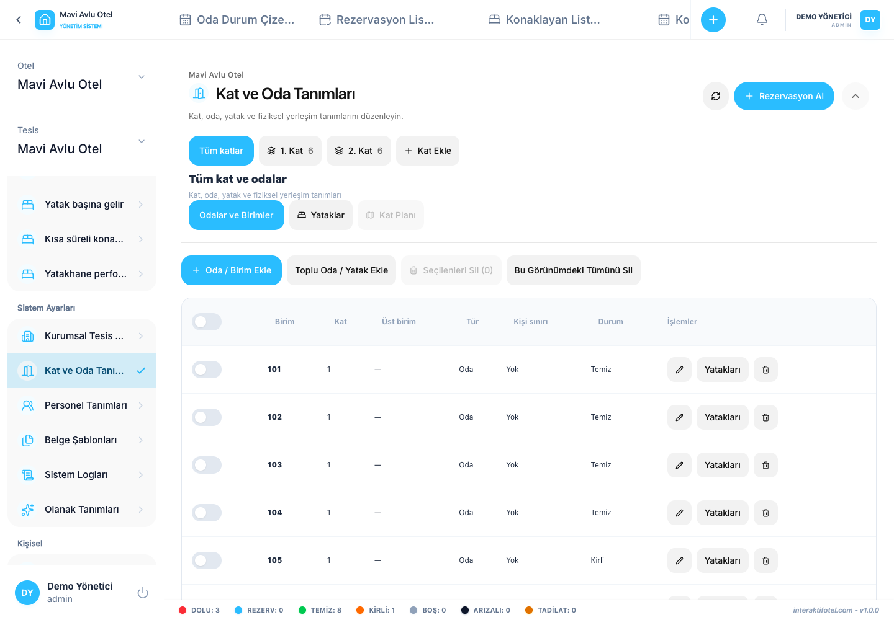

# आवास स्थल, तला, कोठा र अपार्टमेन्ट

खुला होटल शाखा प्रोफाइल र फ्लोर र कोठा परिभाषा।

## संरचनाको योजना बनाउनुहोस्

पदानुक्रम होटेल → होटल शाखा / शाखा → फर्श र एकाइहरू। एक इकाई एक अपार्टमेन्ट, कोठा, छात्रावास वा बिस्तर हुन सक्छ। कोठा एक अपार्टमेन्टको हुन सक्छ, र बेड एक कोठाको हुन सक्छ। भौतिक तल्ला र अभिभावक इकाई अलग सम्बन्ध हो; बहु-तल्लाको अपार्टमेन्ट भित्र कोठा फरक-फरक तल्लामा हुन सक्छ।

## फर्श र एकाइहरू सिर्जना गर्नुहोस्

1. होटल शाखा चयन गर्नुहोस् र फ्लोर र कोठा परिभाषा खोल्नुहोस्।
2. तलको कोड सेट गर्नुहोस्, नाम र क्रम प्रदर्शन गर्नुहोस्। एउटै होटल शाखा भित्रको फ्लोर कोड पुनः प्रयोग नगर्नुहोस्।
3. युनिट फारममा, अपार्टमेन्ट, कोठा वा छात्रावासको प्रकार चयन गर्नुहोस् र यसको कोड प्रविष्ट गर्नुहोस्।
4. उपयुक्त तल्ला र आवश्यक भएमा आमाबाबुको एकाइको व्यवस्था गर्नुहोस्।
5. कोठाको फारममा भाडा मोडको विकल्प पूरा गर्नुहोस्।
6. वास्तविक बेड फर्नीचर, सुविधाहरू र सूची जानकारी थप्नुहोस्।
7. युनिटलाई परिभाषा सूचीमा र सम्बन्धित परिचालन दृश्यमा बचत र जाँच गर्नुहोस्।

## एउटा कोठा भाडामा लिनु वा व्यक्तिगत बेड?

| विकल्प | परिणाम |
| --- | --- |
| सम्पूर्ण कोठा | कोठा आरक्षण इकाई हो; यसको वास्तविक बेड फर्नीचर कोठाको लेआउट वर्णन गर्दछ। |
| व्यक्तिगत बेडहरू | जोडिएका बेड स्पेसहरू छुट्टै प्रस्ताव गरिन्छ। |

कोठाको भाडा मोड पछि थपिएका बेडहरूमा पनि लागू हुन्छ। विद्यमान आरक्षणलाई असर गर्ने परिवर्तनहरू रोक्न सकिन्छ।

## परिभाषा सम्पादन वा मेटाउने

रेकर्ड सम्पादन गर्नुहोस् यसको तल र अभिभावक इकाईको कार्य जाँच गर्न। यदि संरचनात्मक परिवर्तनले पुष्टि गरिएका वा सक्रिय आरक्षणहरूलाई असर गर्छ भने, पहिले तिनीहरूलाई उचित रूपमा सार्नुहोस् वा चेक इन नगरेका आरक्षणहरूको लागि रद्द गर्ने विचार गर्नुहोस्। आवेदनको प्रमाणिकरणलाई पछ्याउनुहोस्, यसलाई बेवास्ता गर्नु भन्दा।

बल्क कार्यहरूको लागि, प्रत्येक चयनित एकाई कोड जाँच गर्नुहोस्। धेरै एकाइहरूमा परिवर्तनहरू लागू गर्नु अघि फिल्टरहरू र चयन गरिएका पङ्क्तिहरू जाँच गर्नुहोस्।

जारी राख्नुहोस् [बिछौना र बिछौनीहरू](beds.md) र [सुविधा र सूची](amenities.md).
