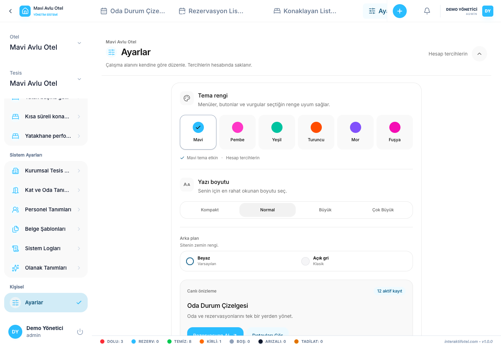

# 语言、主题与个人显示偏好

开设设置和接口中的相关偏好控制.

## 调整接口

1. 用自己的帐户打开设置.
2. 选择适合您的工作的主题,背景和字体尺寸.
3. 检查语言和国家/货币格式偏好.
4. 根据需要调整页面标题,侧行和日历/当前客人的视图.
5. 转到另一个页面,并检查是否保留了偏好.

主题,语言和外观属于登录用户. 如果出现保存错误,请从设置中重新尝试. 改变语言不会改变客人的注册国籍或转换所选择的货币.

## 公开网站上的语言

在首次访问时,网站自动从浏览器的语言偏好中选择首个支持的语言. 之前的手动选择优先考虑. 如果没有浏览器语言支持,则使用土耳其语.

家庭,价格,截图和联系页面提供60种语言. 打开语言菜单,按名字或代码搜索,然后选择语言. 在箭头键上,选择输入选项;逃跑关闭菜单. 语言名称在旗子旁边显示.

公共页面翻译覆盖并不意味着每个应用程序屏幕都被翻译到相同的程度. 缺失的目录标签可能会出现在英语中. 文件模板需要每个语言的单独内容.

## 小屏幕

使用移动菜单访问相同的页面. 需要时,在宽桌中滚动. 在检查所有字段和保存结果之前,不要关闭表格.
