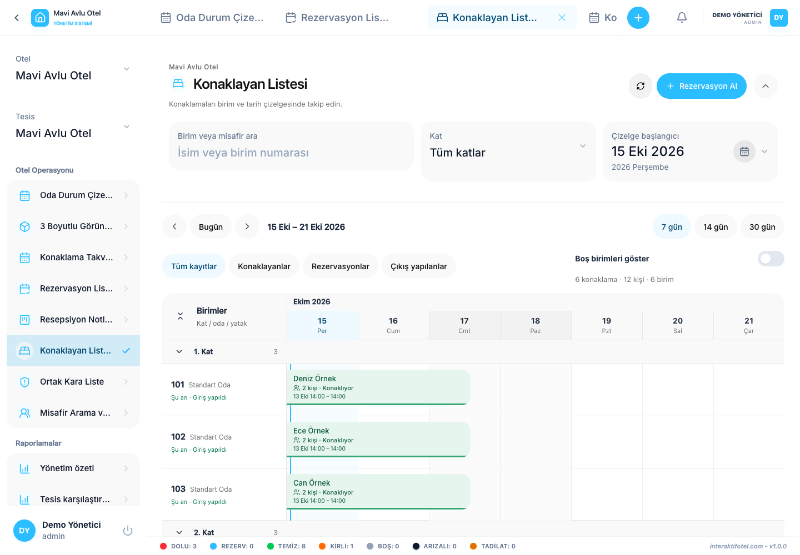

# 住宿日历与在住客人

## 保持日历

1. 从菜单中打开逗留日历.
2. 导航到所需的时间,然后选择每天,每周或每月的视图.
3. 通过搜索和状态过选器缩小结果.
4. 选择一个住宿,检查客人,日期,笔记和每晚的价格.
5. 在改变时间段或过 ?? 后,确认结果与新选择匹配.

欧盟对欧盟的欧盟和欧盟的合作伙伴关系 在浏览器的打印对话框中打开可见的日历. 选择一个PDF目的地,以保存为文件.

## 目前的客人

使用当前客户来追踪正在进行的逗留和计划出发. 在页面标题中,搜索,地板选择和开始日期. 如果这些控制器隐藏,请扩大标题. 根据需要调整时间导航,状态,日数和空单元控制.

区分计划日期与实际抵达和出发时间. 早期登记和房间搬迁可能会使实际搬迁与计划期间不同.

在假设记录消失之前, 清除酒店分支, 日期,楼层,状态和搜索过濾器, 再检查.

接下来: [客人搜索和历史](../guests/history.md).
